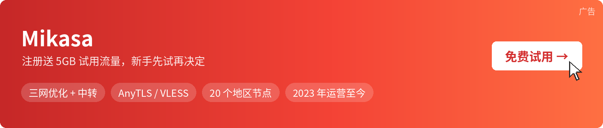

### 🚀最后更新时间: 2026-11-14 17:06:35

# Mikasa 免费节点（新手入门：订阅怎么用、免费和付费的区别）

本仓库自动更新 Mikasa 的公益免费节点订阅。第一次用也没关系，下面从「订阅链接是什么」讲起，照着做 3 步就能连上。

- 公益流量用完后，脚本会自动换上新的订阅链接，最后更新时间见第一行。
- 节点全部超时，回本页复制新链接，在客户端里重新更新订阅。

[](https://6z5lnh.mikasaaff.com/RmfKB6Yg)

| Mikasa | 注册送 5GB 试用流量 · 三网优化 + 中转 · AnyTLS / VLESS · 20 个地区 · 2023 年运营 | [点击注册 Mikasa →](https://6z5lnh.mikasaaff.com/RmfKB6Yg) |
|---|---|---|

## 免费节点订阅链接

### 🚀免费节点订阅链接（各系统常见客户端通用）

```
https://eSjjpl.mcsslk.xyz/e89441bee28417ae1dd5c44f1df154a7
```

## 新手先看：订阅链接是什么

- **节点**：一台帮你转发网络流量的服务器，名字一般带地区，比如「香港」「日本」。
- **订阅链接**：一串网址，里面打包了一组节点。把它粘进客户端，客户端就会自动下载全部节点，以后节点有变化，点一下「更新订阅」就行。
- **客户端**：手机或电脑上用来导入订阅、连接节点的软件。不同系统用不同的客户端，但同一个订阅链接都能用。

## 3 步上手

1. **装客户端**：按下面的表格，选你设备对应的那一个，只从官方地址下载。
2. **导入订阅**：复制上面的订阅链接，在客户端里找「订阅」「配置」或「+」，粘贴后导入并更新。
3. **选节点、开连接**：先做一次延迟测试，选一个有延迟数字的节点，再打开客户端的连接开关（电脑上叫「系统代理」）。

| 设备 | 推荐客户端 | 官方下载 | 中文教程 |
|---|---|---|---|
| Windows / macOS | Clash Verge Rev | [GitHub Releases](https://github.com/clash-verge-rev/clash-verge-rev/releases) | [Clash Verge Rev 教程](https://volya2026.github.io/proxy-client-guide/clash-verge-rev/) |
| macOS（另一种选择） | Clash Party | [GitHub Releases](https://github.com/mihomo-party-org/clash-party/releases) | [Clash Party 教程](https://volya2026.github.io/proxy-client-guide/clash-party/) |
| 安卓 | Clash Meta for Android | [GitHub Releases](https://github.com/MetaCubeX/ClashMetaForAndroid/releases) | [Clash Meta for Android 教程](https://volya2026.github.io/proxy-client-guide/clash-meta-for-android/) |
| 安卓 / 电脑都想用同一个 | FlClash | [GitHub Releases](https://github.com/chen08209/FlClash/releases) | [FlClash 教程](https://volya2026.github.io/proxy-client-guide/flclash/) |
| iPhone / iPad | Shadowrocket（小火箭） | [App Store](https://apps.apple.com/us/app/shadowrocket/id932747118)（付费，中国大陆区商店搜不到；AnyTLS 需 2.2.64 及以上版本） | — |

拿不准就这样选：电脑用 Clash Verge Rev，安卓用 Clash Meta for Android，苹果手机用小火箭。教程里每一步都有截图。

## 免费节点和自己的账号有什么区别

| 对比 | 本仓库免费节点 | 自己注册的 Mikasa 账号 |
|---|---|---|
| 订阅链接 | 流量用完就换，要常回来复制 | 专属链接，一直用同一个 |
| 流量 | 所有人共用一份 | 套餐里的流量只有你自己用 |
| 速度 | 晚上人多明显变慢 | 不和别人抢同一份公益流量 |
| 设备 | 不限，但人越多越慢 | 3 台设备同时用 |
| 适合 | 临时查资料、先体验一下 | 每天都要用、办公、看视频、用 AI 工具 |

先用免费节点体验没问题。觉得每天都离不开了，再考虑自己的账号。注册就送 5GB 试用流量，可以先用专属订阅对比一下，再决定要不要买：

| Mikasa | 注册送 5GB 试用流量 · 三网优化 + 中转 · AnyTLS / VLESS · 3 台设备同时用 | [点击注册 Mikasa →](https://6z5lnh.mikasaaff.com/RmfKB6Yg) |
|---|---|---|

## 常见问题

**导入后节点全部超时，或者订阅打不开？**<br/>
先确认客户端是最新版本（用上面表格里的官方地址更新）；再在客户端里更新订阅；还不行就回到本页，看第一行的更新时间，复制最新链接重新导入。链接的流量用完也会全部超时，这时本页一般已经换上了新链接。

**连上了，但国内网站变慢或打不开？**<br/>
把客户端的模式改成「规则」：国内网站直连，国外网站才走节点。不要长期开「全局」。

**多久更新一次？**<br/>
不按固定时间。脚本会自动检测，链接的流量用完就换上新的，所以一天可能更新好几次，以第一行的时间为准。

**能用来下载大文件吗？**<br/>
请不要。流量是大家共用的，下载大文件会很快把链接的流量用完，影响所有人。

## 延伸阅读

- [Mikasa 机场评测](https://tuijianvpn.com/2886)：套餐、线路和使用体验的完整介绍。
